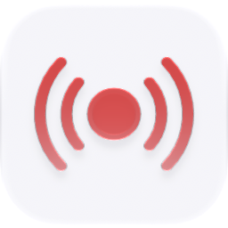
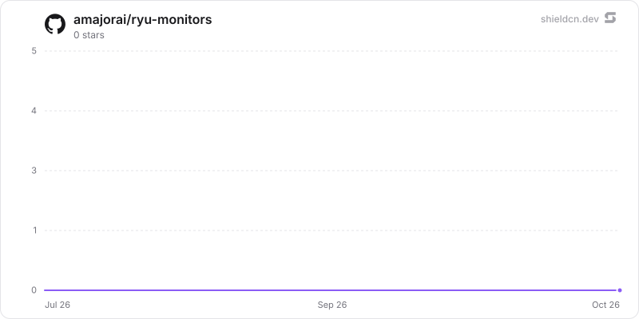

<p align="center">
  <picture>
    <source media="(prefers-color-scheme: dark)" srcset="./icon-dark.png" />
    
  </picture>
</p>

<div align="center">

# Monitors

</div>

Price / stock / keyword / content-diff / uptime watches with cross-device notification fan-out.

> **The public home of `ryu-monitors`.** Source, builds, and releases live here —
> binaries for every platform are attached to each release.
>
> This tree is generated from the Ryu monorepo, so commits pushed here
> directly are replaced on the next sync. **Pull requests are welcome** —
> open them here and they are ported into the monorepo, then flow back out.
> Ryu as a whole: https://github.com/amajorai/ryu

## Install

**App:** [Install](ryu://apps/@ryu/monitors) (opens the Ryu desktop app and asks you to confirm)

**CLI:**

```bash
ryu apps add @ryu/monitors
```

**From source:**

```bash
cargo build --release --manifest-path backend/Cargo.toml
```

Prebuilt binaries for every platform are attached to [each release](https://github.com/amajorai/ryu/releases).

## License

Apache-2.0 — see [LICENSE](./LICENSE).

## Parts

- **`backend/` (`ryu-monitors`)** — an extracted Core capability crate: the check engine,
  the SQLite `MonitorStore`, and the `/api/monitors/*` HTTP surface. **Now served
  OUT-OF-PROCESS** by the `ryu-monitors` bin (`[[bin]]`, `kind:local`, `public_mount`,
  `RYU_MONITORS_BIN`/`RYU_MONITORS_PORT`, default `:8003`); Core links **zero monitor code**
  (no path-dep). Timing goes through Core's generic app-job contract: Core reconciles one
  `app_job` per monitor from this app's `jobs.list` capability (`POST /list`) and runs each
  due check through `jobs.run` (`POST /run`); the sidecar reaches BACK
  via ext-bearer host callbacks (Spider fetch, provider usage reads, and alert fan-out). **The shared
  notification-delivery store no longer lives here** — it was extracted to the kernel crate
  `ryu-notify` + `apps/core/src/notify/` (see the repo root); the sidecar shares only the
  dep-light `ryu-notify` wire types. Remaining cross-cutting calls are inverted through the
  `MonitorsHost` trait, so the crate has **zero dependency on `apps/core`**.
- **`ui/` (`@ryu/monitors-app`)** — the companion surface: a React app built to one
  self-contained HTML via `vite-plugin-singlefile`. Full-page Companion (Path B,
  `ui_format: "html"`).

## Manifest

- **id** `@ryu/monitors` · companion `Monitors` (icon `radar`).
- **grant** `monitors:crud` — the bridge capability the UI drives `/api/monitors/*`
  through.
- **grant** `subscriptions:read` — feeds the provider-reset form's provider, account, and
  usage pickers through `window.ryu.subscriptions` (node owner/admin only; account labels
  may be emails and are rendered, never persisted). The UI feature-detects it and falls
  back to the legacy account-blind `monitors.usage*` methods on older hosts.

## Provider account scope

`provider_usage_reset` checks take an optional `account_id`. Absent follows the active
account: each snapshot stores `{ providerId, accountId, targets }` with the account actually
read, a baseline is compared only when both ids match, and an active-account switch
re-baselines with an `account changed` note instead of alerting. A pinned `account_id` is
forwarded to Core's `usage.query`; an unknown account fails the check (`account_not_found`)
and a reading attributed to another account is refused. Legacy snapshots without
`accountId` re-baseline once. Alerts and snapshots carry ids only, never labels.

## Shared infrastructure

The HTTP monitor backend uses Ryu's shared `ryu-egress` primitive for URL scheme
screening, DNS/IP pinning, redirect re-screening, and response limits. The app owns
the check semantics; it does not vendor a second SSRF policy.

## Surface

`/api/monitors` (list/create) · per-monitor `run`, `snapshots`, `alerts` · `alerts` +
`alerts/stream` (SSE) + `alerts/:id/ack` · `usage/providers` and `usage/query` for provider-reset
monitors.

## Swap seam

Check type and fetch backend are both extensible enums routed through one engine; timing
reuses Core's scheduler as generic app jobs (`jobs.list` / `jobs.run`). A monitor's name,
interval and paused state drive its job, so pause a monitor here, not in Ryu's schedules. Notification targets (webhook / Telegram /
Expo push / BYO SMTP email) are per-monitor, none hardcoded.

## Star History

<a href="https://github.com/amajorai/ryu-monitors/stargazers">
  <picture>
    <source media="(prefers-color-scheme: dark)" srcset="./.github/shieldcn/star-chart-dark.svg" />
    
  </picture>
</a>
